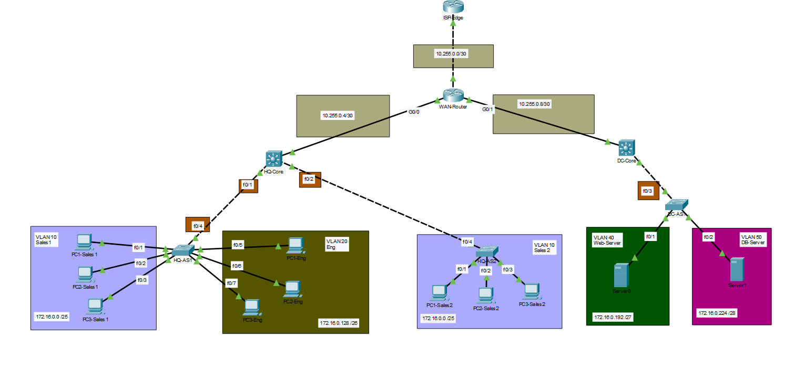

# Multi-Site Enterprise Campus & Data Center Network Architecture

A production-grade, multi-site enterprise network topology designed, configured, and verified in Cisco Packet Tracer. This project demonstrates core CCNA enterprise networking principles, including VLSM subnetting, Layer 3 switching with SVIs, Layer 2 trunk hardening, routed interfaces, and symmetrical multi-hop static routing across WAN and simulated ISP boundaries.

---

## 📐 Network Topology



The infrastructure represents a distributed enterprise deployment split across three core functional domains:
1. **Headquarters (HQ Campus):** Access-Core hierarchy hosting end-user departments (Sales & Engineering).
2. **Data Center (DC):** Isolated server infrastructure domain hosting critical web and database services.
3. **WAN & Internet Edge:** Centralized routing hub interconnecting campus sites and forwarding egress traffic to a simulated Internet edge (`8.8.8.8`).

---

## 📊 IP Addressing & VLAN Allocation Scheme

The network utilizes a **VLSM (Variable Length Subnet Mask)** scheme based on the `172.16.0.0/16` private IP block for end hosts/servers and `10.255.0.0/30` subnets for point-to-point infrastructure links.

### Host & Server VLANs

| Site | VLAN ID | Subnet Name | Network Address | CIDR / Netmask | Gateway (SVI IP) | Host Range |
| :--- | :---: | :--- | :--- | :---: | :--- | :--- |
| **HQ** | 10 | HQ-Sales | `172.16.0.0` | `/25` (`255.255.255.128`) | `172.16.0.1` | `172.16.0.2` – `172.16.0.126` |
| **HQ** | 20 | HQ-Engineering | `172.16.0.128` | `/26` (`255.255.255.192`) | `172.16.0.129` | `172.16.0.130` – `172.16.0.190` |
| **DC** | 40 | DC-Web-Server | `172.16.0.192` | `/27` (`255.255.255.224`) | `172.16.0.193` | `172.16.0.194` – `172.16.0.222` |
| **DC** | 50 | DC-DB-Server | `172.16.0.224` | `/28` (`255.255.255.240`) | `172.16.0.225` | `172.16.0.226` – `172.16.0.238` |
| **All**| 99 | Management | Variable | `/24` (`255.255.255.0`) | N/A | Out-of-band management |

### Infrastructure Point-to-Point Links (`/30`)

| Interconnect Link | Subnet ID | CIDR / Netmask | Device A (Interface / IP) | Device B (Interface / IP) |
| :--- | :--- | :---: | :--- | :--- |
| **ISP-Edge $\leftrightarrow$ WAN-Router** | `10.255.0.0` | `/30` (`255.255.255.252`) | ISP-Edge (`Gi0/0/0` - `10.255.0.2`) | WAN-Router (`Gi0/0/2` - `10.255.0.1`) |
| **HQ-Core $\leftrightarrow$ WAN-Router** | `10.255.0.4` | `/30` (`255.255.255.252`) | HQ-Core (`Gi1/0/1` - `10.255.0.5`) | WAN-Router (`Gi0/0/0` - `10.255.0.6`) |
| **DC-Core $\leftrightarrow$ WAN-Router** | `10.255.0.8` | `/30` (`255.255.255.252`) | DC-Core (`Gi1/0/1` - `10.255.0.9`) | WAN-Router (`Gi0/0/1` - `10.255.0.10`) |

---

## 🎯 Key Architectural Decisions ("The WHY")

### 1. Switched Virtual Interfaces (SVIs) for Core Routing
* **Decision:** Inter-VLAN routing is performed locally at the distribution/core layer (`HQ-Core` and `DC-Core`) using SVIs rather than a Router-on-a-Stick setup.
* **Engineering Rationale:** Local SVIs route intra-campus traffic (e.g., VLAN 10 $\leftrightarrow$ VLAN 20) at wire-speed on dedicated ASIC hardware. This prevents local traffic from traversing WAN links, eliminating bandwidth bottlenecks.

### 2. VLSM Address Optimization
* **Decision:** Subnet masks range from `/25` down to `/28` depending on host density requirements.
* **Engineering Rationale:** Prevents IPv4 address exhaustion, bounds broadcast domain sizes to manageable host numbers, and establishes clean boundaries for future route summarization.

### 3. Isolated `/30` Infrastructure Subnets
* **Decision:** All point-to-point links between routers and Layer 3 switches use `/30` subnets.
* **Engineering Rationale:** A `/30` subnet yields exactly 2 usable host IPs ($2^{32-30} - 2 = 2$). Using standard `/24` networks for point-to-point links wastes 252 host IPs per link and introduces unnecessary broadcast overhead.

### 4. Layer 2 Boundary Containment (`no switchport`)
* **Decision:** Switch interfaces on `HQ-Core` and `DC-Core` facing `WAN-Router` are configured as Layer 3 routed ports (`no switchport`).
* **Engineering Rationale:** Disabling Layer 2 switching on Core-to-WAN links completely confines Spanning Tree Protocol (STP) topologies and Layer 2 broadcast domains within local campus boundaries, eliminating risk of WAN-wide switching loops.

### 5. Trunk Link Hardening & Management Isolation
* **Decision:** Switch-to-switch uplinks are configured as 802.1Q trunks with custom Native VLAN 99, even for switches currently carrying a single user VLAN (`HQ-AS2`).
* **Engineering Rationale:** 
  1. Out-of-band management requires SSH/SNMP access to switches on Management VLAN 99 alongside user traffic.
  2. Ensures the infrastructure can seamlessly scale new VLANs (e.g., VoIP, Security Cameras) without link re-configuration.
  3. Changing Native VLAN from default VLAN 1 mitigates VLAN Hopping security threats.

### 6. External Target Simulation via Loopback0
* **Decision:** ISP-Edge configured with logical interface `Loopback0` (`8.8.8.8/32`).
* **Engineering Rationale:** Physical interfaces can experience line-protocol failures. Software-defined Loopbacks remain permanently `UP/UP`, providing a deterministic IP endpoint to validate default route propagation (`0.0.0.0/0`) and external WAN egress reachability.

---

## 🧪 Verification & Path Validation

### 1. Control Plane Validation (`show ip route`)

```text
WAN-Router# show ip route
Gateway of last resort is 10.255.0.2 to network 0.0.0.0

S*    0.0.0.0/0 [1/0] via 10.255.0.2
      10.0.0.0/8 is subnetted, 3 subnets
C        10.255.0.0/30 is directly connected, GigabitEthernet0/0/2
C        10.255.0.4/30 is directly connected, GigabitEthernet0/0/0
C        10.255.0.8/30 is directly connected, GigabitEthernet0/0/1
      172.16.0.0/16 is subnetted, 4 subnets
S        172.16.0.0/25 [1/0] via 10.255.0.5
S        172.16.0.128/26 [1/0] via 10.255.0.5
S        172.16.0.192/27 [1/0] via 10.255.0.9
S        172.16.0.224/28 [1/0] via 10.255.0.9
```

### 2. End-to-End Data Plane Verification

Executing verification from **`PC1-Sales1`** (`172.16.0.10`):

```cmd
:: 1. Local Gateway (HQ-Core SVI 10)
C:\> ping 172.16.0.1
Reply from 172.16.0.1: bytes=32 time<1ms TTL=255

:: 2. Cross-VLAN Intra-Campus (HQ Engineering)
C:\> ping 172.16.0.130
Reply from 172.16.0.130: bytes=32 time=1ms TTL=254

:: 3. Cross-Site Data Center (DB Server)
C:\> ping 172.16.0.226
Reply from 172.16.0.226: bytes=32 time=2ms TTL=252

:: 4. Simulated Internet Egress
C:\> ping 8.8.8.8
Reply from 8.8.8.8: bytes=32 time=3ms TTL=251
```

### 3. Multi-Hop Trace Route Inspection

```cmd
C:\> tracert 8.8.8.8

Tracing route to 8.8.8.8 over a maximum of 30 hops:

  1    <1 ms    <1 ms    <1 ms  172.16.0.1   [HQ-Core SVI 10 Gateway]
  2     1 ms     1 ms     1 ms  10.255.0.6   [WAN-Router Inbound Link]
  3     2 ms     1 ms     2 ms  10.255.0.2   [ISP-Edge Inbound Link]
  4     2 ms     2 ms     2 ms  8.8.8.8      [ISP Loopback0 Target]

Trace complete.
```

---

## 📁 Repository Structure

```text
multi-site-enterprise-lab/
│
├── diagrams/
│   └── network_topology.jpg         # High-resolution architectural diagram
│
├── topologies/
│   └── MultiSite_Enterprise.pkt     # Cisco Packet Tracer (.pkt) lab file
│
├── configs/
│   ├── HQ-Core.txt                  # Running configuration for HQ Core L3 Switch
│   ├── DC-Core.txt                  # Running configuration for DC Core L3 Switch
│   ├── WAN-Router.txt               # Running configuration for Central WAN Router
│   ├── ISP-Edge.txt                 # Running configuration for ISP Edge Router
│   ├── HQ-AS1.txt                   # Access Switch 1 configuration
│   ├── HQ-AS2.txt                   # Access Switch 2 configuration
│   └── DC-AS1.txt                   # DC Access Switch configuration
│
└── README.md                        # Technical project documentation
```

---

## 🚀 Deployment Instructions

1. **Clone the Repository:**
   ```bash
   git clone https://github.com/your-username/multi-site-enterprise-lab.git
   ```
2. **Open Topology File:**
   * Open `topologies/MultiSite_Enterprise.pkt` using **Cisco Packet Tracer v8.0+**.
3. **Verify Configuration:**
   * Open the CLI on any device and compare running configurations against text exports in `configs/`.
4. **Test Connectivity:**
   * Open the Command Prompt on `PC1-Sales1` and execute `ping 8.8.8.8` or `tracert 8.8.8.8`.